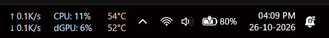

# TrafficMonitorPlus+

<p align="center">
  
</p>

<p align="center">
  <strong>A high-performance Windows taskbar & floating hardware monitor with dynamic color-reactive heat transitions and telemetry.</strong>
</p>

<p align="center">
  <a href="https://github.com/zhongyang219/TrafficMonitor"></a>
  
  
  
</p>

---

<p align="center">
  
</p>
<p align="center">
  <em>Live real-time telemetry seamlessly integrated into the Windows 11 Taskbar with dynamic color-reactive heat transitions.</em>
</p>

---

## 🌟 Introduction

**TrafficMonitorPlus+** is an enhanced, feature-rich edition of the popular Windows monitoring utility. Designed for power users, gamers, and developers, TrafficMonitorPlus+ seamlessly embeds real-time network speeds, CPU/GPU temperatures, memory usage, and battery telemetry directly into your Windows taskbar or a sleek desktop floating widget.

Maintained and upgraded by **Yashwant Mandal**, TrafficMonitorPlus+ introduces intelligent thermal heat color transitions, hybrid laptop graphics intelligence, a redesigned modern configuration interface, and updated Windows 11 branding.

---

## 🙏 Credits & Acknowledgements

TrafficMonitorPlus+ is built upon the wonderful foundation of the open-source **TrafficMonitor** project:

* **Original Creator & Lead Developer:** **Zhong Yang ([@zhongyang219](https://github.com/zhongyang219))**  
  * Original Repository: [github.com/zhongyang219/TrafficMonitor](https://github.com/zhongyang219/TrafficMonitor)  
  * Deepest thanks and respect to Zhong Yang and the original contributors for creating this indispensable tool.
* **Hardware Telemetry Provider:** [LibreHardwareMonitor](https://github.com/LibreHardwareMonitor/LibreHardwareMonitor) for sensor access across CPUs, GPUs, motherboards, and storage drives.
* **XML Parser:** [TinyXML2](https://github.com/leethomason/tinyxml2) by Lee Thomason.

---

## ✨ What's New in TrafficMonitorPlus+

### 1. 🌡️ Dynamic Color-Reactive Thermal Heat Display
* Monitors CPU and GPU temperatures and loads in real time.
* Dynamically shifts text colors through an intuitive thermal spectrum:
  * **Cool / Normal:** Crisp theme text (e.g. White / Silver)
  * **Warm:** Vivid Warm Yellow
  * **High Load:** Radiant Amber / Orange
  * **Critical:** Bright Red Alert
* Visual feedback at a single glance without cluttering the taskbar.

### 2. ⚡ Hybrid Laptop Graphics Telemetry
* Automatic detection for laptops with dual graphics (integrated iGPU + discrete dGPU).
* Intelligently shows active dedicated GPU usage and temperature when gaming or rendering, and sleeps cleanly during low-power battery usage.

### 3. 🔋 Battery Wattage & Discharge Monitoring
* Live battery discharge and charging wattage rate (W) telemetry.
* **Live Display Refresh Rate (Hz):** Real-time screen refresh rate telemetry (e.g. 60Hz, 120Hz, 144Hz DRR) in the info tooltip (off by default, togglable with 1-click via taskbar menu).
* Instant power-draw feedback to identify battery-draining background apps.

### 4. 🎨 Redesigned Option Settings Dashboard
* Completely restructured **460 × 310 DLU** spacious dialog layout.
* Modern two-column card architecture:
  * **Left Column:** Window Layout & Telemetry Item Ordering.
  * **Right Column:** Font, Color Themes & Preview.
* **Zero vertical scrollbars:** All controls, labels, and color buttons are directly accessible without scrolling.
* Clearer, intuitive button labels (e.g. `Display Items & Order...`, `Customize Labels...`).

### 5. 💎 Modern Windows 11 Fluent Icon & Branding
* Modern squircle icon with high-contrast waveform and glowing `+` indicator.
* Fully crisp multi-resolution assets (16x16 up to 256x256) for sharp taskbar and High-DPI screen rendering.
* Clean Segoe UI typography across all dialogs.

---

## 🚀 Key Features

* **Taskbar Embedding:** Embeds smoothly into Windows 10 and Windows 11 taskbars (both centered and left-aligned).
* **Network Speed Telemetry:** Real-time upload and download speed graphs and metrics with auto-scaling units (KB/s, MB/s).
* **Comprehensive Hardware Metrics:**
  * CPU Usage (%), Frequency (GHz), and Core Temperatures (°C / °F).
  * RAM Usage (%) and Available Physical Memory.
  * Dedicated & Integrated GPU Usage (%) and Temperatures.
  * Hard Disk Activity (%) and Temperature.
  * Motherboard temperature and Battery capacity / power rate.
* **Floating Desktop Window:** Optional customizable desktop overlay with mouse-penetration (click-through) support.
* **Skinning Engine:** Supports custom XML/PNG skins, transparencies, and background graphics.
* **Plugin Architecture:** Extensible via C++ dynamic plugins.
* **Traffic Statistics:** Historical daily, weekly, and monthly data consumption tracking.

---

## 🚀 Quick Installation (Windows 11 & 10)

Anyone can easily install and start running **TrafficMonitorPlus+** in under 10 seconds on any new Windows PC using either simple commands or downloading from Git:

### Method 1: Instant 1-Command Install (Fastest for Any Windows 11 PC)
Open **PowerShell**, **Windows Terminal**, or **CMD** and paste the command below:

**PowerShell / Windows Terminal (Recommended):**
```powershell
irm https://raw.githubusercontent.com/yashwantmandal26/TrafficMonitorPlus/master/install.ps1 | iex
```

**Command Prompt (CMD):**
```cmd
powershell -ExecutionPolicy Bypass -Command "irm https://raw.githubusercontent.com/yashwantmandal26/TrafficMonitorPlus/master/install.ps1 | iex"
```

> **What this command does automatically:**
> 1. Self-elevates to Administrator (with standard UAC prompt for hardware sensor telemetry).
> 2. Downloads and unpacks the latest release package cleanly.
> 3. Installs directly to `C:\Program Files\TrafficMonitorPlus+\`.
> 4. Creates **Desktop** and **Start Menu** shortcuts.
> 5. Configures **Silent Auto-Start on Windows Boot** (starts on logon with zero UAC popups).
> 6. **Instantly launches TrafficMonitorPlus+** into your Windows 11 taskbar!

---

### Method 2: Download File from Git

#### Option A: Download Single Installer Script (`install.bat`)
1. Download **[`install.bat`](https://raw.githubusercontent.com/yashwantmandal26/TrafficMonitorPlus/master/install.bat)** from this repository.
2. Double-click **`install.bat`**.
3. It automatically downloads the latest release from GitHub, installs everything, and starts running immediately!

#### Option B: Download Release ZIP Package
1. **Download** the latest `TrafficMonitorPlus+_v1.86_x64.zip` from [Releases](https://github.com/yashwantmandal26/TrafficMonitorPlus/releases).
2. **Extract** the zip file to any folder.
3. **Double-click `install.bat`** (or `Install_TrafficMonitorPlus+.bat`).
4. It instantly installs to `C:\Program Files\TrafficMonitorPlus+\` and launches the app!

#### Option C: Portable Mode (Zero Installation)
If you prefer not to install into `Program Files`:
* Extract the zip and run **`TrafficMonitorPlus+.exe`** directly from any folder or USB drive.

> [!NOTE]
> *If Windows SmartScreen shows "Windows protected your PC", simply click **"More info"** -> **"Run anyway"** (standard for open-source GitHub utilities).*

### 🗑️ How to Uninstall
* Double-click **`Uninstall_TrafficMonitorPlus+.bat`** (or search "Uninstall TrafficMonitorPlus+" in your Start Menu). It stops the app, removes the auto-start task, deletes shortcuts, and cleans up all files with zero leftovers.

---

## 🛠️ System Requirements & Build Instructions

### Requirements
* **Operating System:** Windows 10 (version 1809 or later) or Windows 11 (x64 / ARM64).
* **Runtime:** Microsoft Visual C++ 2015–2022 Redistributable (x64).
* **Administrator Privileges:** Recommended for low-level CPU/GPU hardware sensor readouts.

### Building from Source
1. Clone the repository:
   ```bash
   git clone https://github.com/yashwantmandal26/TrafficMonitorPlus.git
   cd TrafficMonitorPlus
   ```
2. Open `TrafficMonitor.sln` in **Visual Studio 2022** with the following workloads installed:
   * Desktop development with C++
   * C++/CLI support for v143 build tools
   * .NET Framework 4.7.2 / 4.8 Targeting Pack
3. Select **Release** and **x64** configuration.
4. Build the solution (`Ctrl + Shift + B`).

---

## 📖 Usage Guide

1. **Launch:** Run `TrafficMonitor.exe` (as Administrator for hardware sensor access).
2. **Show Taskbar Window:** Right-click the desktop widget or system tray icon and select **Show Taskbar Window**.
3. **Configure Telemetry:**
   * Right-click the taskbar telemetry area $\rightarrow$ select **Taskbar Settings...**
   * Click **Display Items & Order...** to choose which metrics appear and reorder them.
   * Enable **Dynamic Color Transitions** for reactive heat colors.
4. **Change Fonts & Colors:** Select your favorite fonts and colors in the redesigned settings dashboard.

---

## 📄 License & Disclaimers

* **License:** Distributed under the Anti-996 License, honoring the original TrafficMonitor open-source licensing.
* **Credits:** Original codebase and architecture &copy; **Zhong Yang ([@zhongyang219](https://github.com/zhongyang219))**.
* **Modifications & Enhancements:** &copy; 2026 **Yashwant Mandal**.
